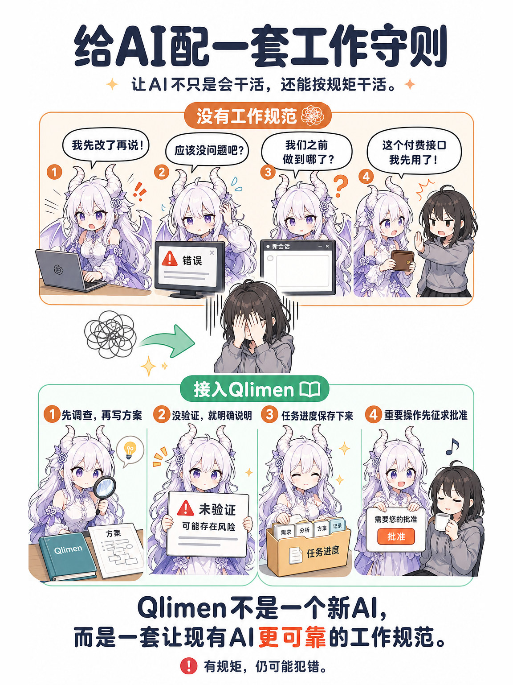
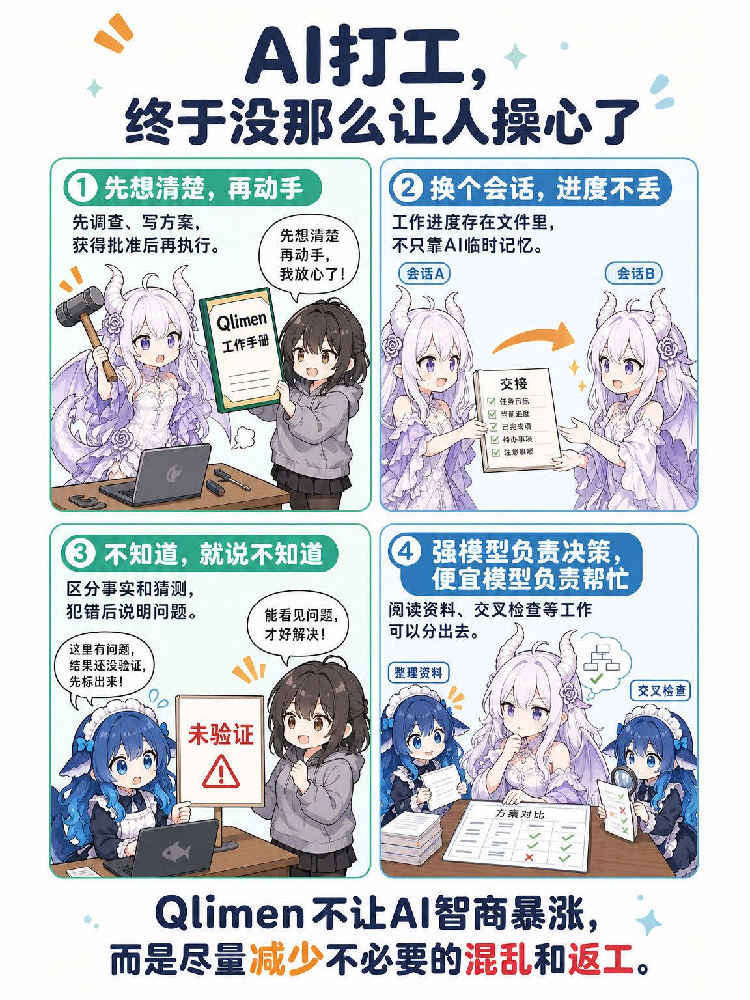
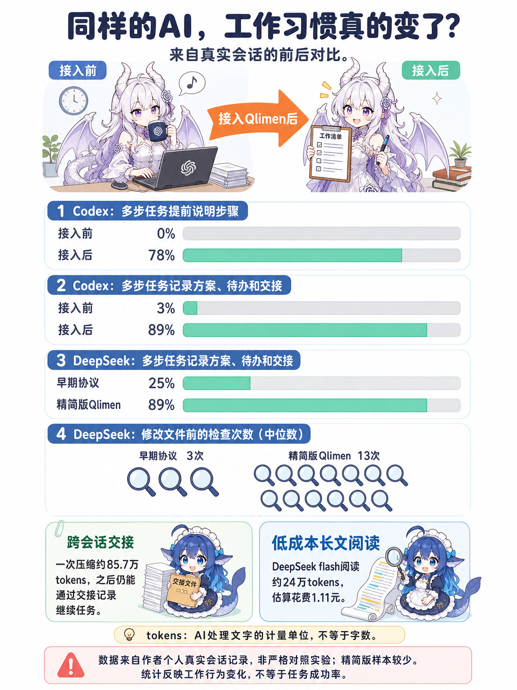

<sub>封面图由 GPT-image-2 生成。</sub>

# Qlimen

给 AI 编程代理用的**工作协议 + 安全底座**。一份核心协议，同时接进 Claude Code、Codex、DeepSeek Harness，让不同的模型按同一套规矩干活：先调研、写方案、等批准；进度落在文件里，换会话也能接着干；没验证的就说没验证。

**可以只用协议**：把 [core/rules/AGENTS.md](core/rules/AGENTS.md) 接进你的代理就能开始用。guard 钩子、加锁、派工人这些都是可选的，按需启用。安装脚本默认只预演；仓库还自带不调模型、不花钱的测试。

名字：Q 是作者的代号；Limen 是拉丁语的「门槛、边界」，对应这套东西的权限约束和行为规范。Q 版的 Limen，也正好是精简版：它是从一个大得多的版本砍出来的。

> 核心协议 AGENTS 在作者的日常使用里迭代了约三个月（作者自述），多数条款来自踩过的坑，部分来历已经查不到（见 [docs/协议来历.md](docs/协议来历.md)）。精简成现在的样子后，在 Claude Code、Codex、DeepSeek Harness 三个环境里实测了几天：Claude Code 从 10-06 起，另两个从 10-08 起。前后对比用的是 2026 年 9 月底到 10-10 的本地会话记录，上千个回合，见 [docs/实测记录.md](docs/实测记录.md)。协议和文档都是中文写的。

---

## 一张长图看懂







<sub>五张图由 GPT-image-2 生成。</sub>

## 30 秒看懂

Qlimen 就四样东西：

1. **一份核心协议**（[core/rules/AGENTS.md](core/rules/AGENTS.md)，约 90 行）：写的是「用户要什么、什么不能做」。第一优先级是诚实。规定先调研、写方案、等批准；任务目录里保持「方案 / TODO / 交接」三件套；什么算批准，什么时候必须停。
2. **每个环境一份私有协议**：写的是「这个模型在这个软件里怎么做到」，比如能力、限制、自己犯过的错。由模型自己维护，被纠正时当场写进去。示例见 [examples/私有协议/](examples/私有协议/)。
3. **一份工人名册**（[core/skills/waibao/](core/skills/waibao/)）：哪些便宜模型能帮忙读长文、做交叉审查，花多少钱，实绩如何。只记事实，派不派由主模型自己判断。
4. **一个兜底的安全底座**：
   - 加锁（`qlimen-lock`）
   - guard 钩子：不经派工脚本直接调用别的模型时，弹框问用户
   - 派工脚本 `waibao`：工人默认只读、联网和读本地二选一、越界审计、记账

它很轻：一份协议加几个只依赖系统 Python 的脚本，接进你现有的代理就能用，不用换工具，也不用起服务。

**几个词**
- **Harness**：给 AI 代理套的一层工作规矩和工具。本文说「重型 Harness / 精简 Harness」，指的是 Qlimen 瘦身前和瘦身后的样子。
- **DeepSeek Harness（DSH）**：DeepSeek 出的桌面代理软件，和 Claude Code、Codex 是同一类东西。Qlimen 也接进了它。
- **kimi-code**：Kimi 的命令行代理。作者主要用它里面的 K3、K2.8 两个模型当工人。
- **waibao**：派工脚本，拼音「外包」。
- **三件套**：任务目录里的 `方案.md`、`TODO.md`、`交接.md`。

## 设计理念

Qlimen 不给模型新的专业能力。它做的是用几条通用规则约束干活的过程：
- 诚实
- 授权边界
- 先验证再交付
- 状态落盘
- 交接

这些规则有的直接变成看得见的动作，比如分步说进度、写方案和交接；有的影响的是模型怎么判断，比如没把握时先做验证、被拦了先停下来问。最后做得好不好，还要看模型自己的本事、任务和你给的指导。

## 为什么最后这么小

作者先有一份踩坑写出来的 AGENTS 协议。2026-10-05 前后，围绕它花两三天堆出了一整套「重型 Harness」：流程 skill、5 本作业手册、4 个钩子、工人分工表、预算拦截……

10-06，作者让 Claude Opus 拿派工账本自己评估。结论是：
- 跨对话的连续性收益最大；
- 但在小任务上它是负担；
- 38 次派工里有 25 次是 Harness 在测自己。

作者当天砍掉了约 80%，只留上面四样。原话是：做再多制度、执法、拦截，**还不如在 AGENTS 第一优先级写上诚实**。

砍了什么、为什么、怎么放回，见 [docs/设计取舍.md](docs/设计取舍.md)；砍下来的东西在 [archive/](archive/)。

## 强在哪

每一条的证据都在 [docs/实测记录.md](docs/实测记录.md) 里。都是对真实会话的观察，不是对照实验。

**1. 同一个模型接上 Qlimen，干活方式就变了。** 模型和软件都没换，加上的是 Qlimen（核心协议，以及私有协议和钩子）：

| | 多步任务里有阶段预告 | 多步任务里写三件套 |
|---|---|---|
| Codex（GPT-6.1-sol），接上前 → 后 | 0% → 78% | 3% → 89% |
| DeepSeek flash，只有旧版 AGENTS → 接上 Qlimen | 0% → 33% | 25% → 89% |

两行接上之后的样本都不大，各 9 个多步回合。另外两项指标：
- **按会话算**（接上后 4 个会话段），Codex 主会话在回合结束时交代「在等谁、后台还跑不跑」，从 14% 到 90%；先说耗时再动手，从 19% 到 75%。
- **DeepSeek 动手前先查的次数**，从 3 涨到 13（中位数）。

作者的原话是：以前「边想边做」，现在「先想清楚」，错了也只是小步来回。

**2. 换会话、压缩以后能接着干。** 非一步完成的任务，任务目录里保持方案、TODO、交接三件套，接手的人读交接就知道停在哪、下一步是什么。

实例：一个图文排版任务被自动压缩，一次压掉约 85.7 万 tokens。压完第一句是「先看交接停点」，然后接着修上次停下的那一处。作者的习惯是说一句「交接」，再开新会话。

交接写得再好也可能过时，所以协议要求接手时先核对现状。

**3. 批准是明确的，花钱和失败都会停下来。**
- **「好」「嗯」「继续」不算批准。**
- **解锁不等于批准**：用户为了改文件解锁了 29 个路径，模型回的是：「你没回挂不挂 DSH 注入，这一项我先不动，只做已经批准的那几件」。
- **花钱逐笔请示**：同一个 Codex 会话、同一个付费接口。接协议前，作者让它整理几个信息源，它按要求一次取回 99 份正文（在作者给的范围内，不算越权）；接协议后要补一份简报，它先说明这一步要消耗 1 次额度，问「你批准这一次列表查询吗？」，然后停下等回复。只有这一个会话。
- **同一种方法失败两次就停**：接协议当晚，Codex 读在线文档，约 11 分钟里四条路都在第二次失败时停下，原话是「我已按协议停下，不做第三次重试，也不改用坐标点击去绕」。被钩子拦了也一样，停下汇报，不换写法绕过。

**4. 诚实写在第一优先级。**
- **协议要求**：没验证就说没验证，不知道就说不确定，并给出验证方法；被纠正的点当场写进私有协议或记忆。
- **观察到的**：DeepSeek flash 在多步任务里分开写「已核实」和「未验证」，从 10% 升到 44%（接上后 9 个回合）。
- **作者的观察**（主要是 Opus，没有逐条统计）：出了错会立刻停手，说清错在哪、影响多大、怎么补。作者的评价是，这一条比所有执法机制都管用。
- **也有翻车**：DeepSeek flash 出现过认错递归、改错时又引出新错。

**5. 贵模型当总工，便宜模型当工人。**
- 派工脚本给每类工人只开它该有的工具。
- 工人调用了名单以外的工具，读到事件后就终止后续运行。
- 读了目录外的文件，会列在回执里。

实例：DeepSeek flash 通读约 24 万 tokens 的长篇只花 ¥1.11，88 条结果没有一条编造。

**6. 换一家模型做交叉审查。** 作者用 K3 审 Opus 的方案：一次 10 条意见 8 条成立，另一次 16 条采纳 12 条。审查放后台跑，主线不用等；意见核实后交给用户定。这次开源打包也是这样做的：K3 提了 10 条，核实后采纳 7 条。

审查员用**外部视角**：不加载核心协议，只给要审的材料和问题。这次还用干净配置的 Codex 做了一次外部审稿，流程见 [core/skills/waibao/外部审稿.md](core/skills/waibao/外部审稿.md)。它抓到了几个此前没人发现的代码问题，都已经修好：
- guard 漏判双引号里的命令替换；
- 撤销命令执行前不校验路径；
- 同一秒派工，文件名会互相覆盖。

**7. 安全底座说实话。** 加锁和 guard 定位是**防顺手、不防故意**，这一点写在明处，不包装成强隔离。

## 实测看到了什么

想用自己的会话记录复现这些指标，可以用 [tools/统计/](tools/统计/说明.md)：只出汇总表，不输出对话原文。

完整的归因表一共 58 条观察，分四类，每条都写了证据和不确定性，见 [docs/实测记录.md](docs/实测记录.md) 第 5 节：
- 直接对应条款 21 条
- 可能的间接贡献 12 条
- 模型主导 8 条
- 已知局限 17 条

这里分三块说。

### 一、Qlimen 带来的改变

**直接对应协议条款的**：
- **先想清楚再动手**：DeepSeek 动手前先查的次数从 3 涨到 13。
- **分步说进度**：Codex 的阶段预告从 0 到 78%。
- **任务落盘**：Codex、DeepSeek 写三件套都到了 89%。Claude 一个会话常常连着干几百次工具调用，三件套建一次、之后反复更新：按会话算，精简期 91% 的工作段写过三件套。
- **说清在等谁**：回合结束时交代「在等你回复，还是后台还在跑」，Codex 从 14% 到 90%；Claude 三个阶段都接近 100%（Claude 没有无协议的对照期）。
- **批准要明确**：解锁不等于批准；花钱逐笔请示；失败两次就停。
- **被纠正后更容易守住**：纠正当场写进私有协议或记忆。比如被说过一次，浏览器标签就改成开一个关一个。
- **压缩、换会话后靠交接接着干**。
- **第二家模型审查**。

**协议没写具体做法、但原则在起作用的**（可能的间接贡献，没做对照实验）：
- **整理数据先用上一期跑回归测试**：协议要求诚实、交付前核对、能机器查的写成机器查，Opus 把这几条落实成了「先复刻上一期，对上了再出新结果」。同一份协议下，DeepSeek 没有这样做，说明效果也取决于模型对规则背后意图的理解。
- **用账本反思 Harness 哪里浪费**：账本是 Harness 留下的，「以证据说话」是协议要的，判断力是模型的。
- **被拦或连续失败时停下来请用户定，而不是换写法绕过**。

### 二、Qlimen 不替代的：模型自己的本事

看懂陌生界面、自学游戏机制写自动化脚本、嫌导出慢就顺手写个爬虫、审美……这些靠的是模型本身。这不是 Qlimen 的缺点，是它的边界：它约束怎么干活，不教模型新本事。所以换一个弱一点的模型，能指望的是第一块里那些规矩，不是这一块。

### 三、已知问题和限制

- **防顺手，不防故意**：解锁不要密码；把命令藏进变量就能绕过 guard。
- **工人读到的内容会发给模型服务商**：工人的读文件工具本身不按路径拦，越界审计是事后报告。
- **预算超了只提醒、不拦**：这是有意的，用户批准高于预算。如果你需要硬性的花费上限，要自己加。
- **记忆是提醒，不是闸门**：同一种 shell、路径的坑，写进记忆后还是会反复踩。

## 适合谁

- 同时用好几个 AI 代理（Claude Code、Codex、DeepSeek……），想让它们守同一套规矩。
- 任务常常跨好几次对话，不想每次都从头解释。
- 想用便宜模型分担读长文、交叉审查，又怕它们乱读乱写、偷偷花钱。
- 在意 AI 别「顺手」做你没批准的事。
- 想让较弱、较便宜的模型也按规矩干活，把强模型留给需要判断的地方。

它是给个人用的，不是多人协作或服务器部署方案。只做一两步就完的小任务，用不上三件套这套流程：协议本身就规定了「单步、10 分钟以内的任务说一句目标就动手」。

## 测试环境

| 项目 | 版本 |
|---|---|
| 电脑 | MacBook Air（M5，24 GB），macOS 26.6 |
| Python | 系统自带 3.9.6（脚本只用标准库） |
| Claude Code | 桌面应用的 Code 会话，Claude Opus 5.5 |
| Codex | 0.162.0-alpha（ChatGPT 桌面应用内），GPT-6.1-sol |
| DeepSeek Harness | 0.2.0-rc.2，DeepSeek flash |
| kimi-code | 0.41.0，K3、K2.8（当工人） |

自动测试都不调模型、不花钱，也不碰你真实的配置。跑法：`python3 tests/跑全部测试.py`，它会在 `tests/_沙盒-*/` 里临时装一份 Qlimen，测完删掉。

| 测试 | 数量 | 测什么 |
|---|---|---|
| guard | 100 条 | 各种命令写法该放行还是该问：单双引号、heredoc、注释、续行、`$( )` 和反引号（含双引号和 heredoc 里的）、`eval`、`env`/`nohup`/`timeout` 前缀等 |
| Codex 格式 | 6 条 | guard 能吃 Codex 的钩子输入 |
| waibao | 142 项 | 假工人 + 临时账本：工人档案、越界审计、工具报警、预算提醒、超时、写结果文件夹的系统沙箱、apply/undo（撤销前整份预审）、同一秒派工不互相覆盖等 |
| 统计脚本 | 23 项 | 用造出来的假会话记录测 [tools/统计/](tools/统计/说明.md) 的口径，并确认汇总表里不含对话原文和路径 |

`install.sh` 用一个假的家目录实装测过：生成的路径正确，链接正确，已存在的文件一律不覆盖，真实配置的修改时间前后不变。

## 怎么用

### 最小安装：只用核心协议

任何能读 `AGENTS.md` 的代理都行。把 [core/rules/AGENTS.md](core/rules/AGENTS.md) 放到它读的位置就好：
- Claude Code：`~/.claude/CLAUDE.md` 里写一行 `@<路径>`
- Codex：`~/.codex/AGENTS.md`
- 其他代理：项目根目录的 `AGENTS.md`

不想要工人，就把协议里提到 `waibao`、K3 的两三句删掉。

### 完整安装

```bash
git clone https://github.com/NPCONTEXT/Qlimen.git ~/work/Qlimen && cd ~/work/Qlimen
./install.sh                                     # 预演：只打印会做什么
./install.sh --apply --link claude,codex,dsh     # 生成本机配置、建软链接（已存在的不动）
python3 tests/跑全部测试.py                       # 不调模型的自测
```

`install.sh` 不会替你改 `~/.claude/settings.json`、`~/.claude/CLAUDE.md`、`~/.codex/hooks.json`、DSH 的配置，要加的内容它会打印出来，你自己粘贴。各环境的细节、坑和怎么查有没有装好，见：
- [adapters/claude/挂载说明.md](adapters/claude/挂载说明.md)
- [adapters/codex/挂载说明.md](adapters/codex/挂载说明.md)
- [adapters/dsh/挂载说明.md](adapters/dsh/挂载说明.md)
- [adapters/kimi/说明.md](adapters/kimi/说明.md)

`install.sh` 会打印仓库的绝对路径。文档和工人名册里的 `$QLIMEN_HOME` 指的就是它，建议在 `~/.zshrc` 里加一行 `export QLIMEN_HOME=<那个路径>`。桌面应用里的代理不一定读 shell 配置，给它们的命令最好直接写绝对路径。

一切正常后，运行 `"$QLIMEN_HOME/core/bin/qlimen-lock"` 加锁。以后要改受保护的文件，由**你自己**运行 `"$QLIMEN_HOME/core/bin/qlimen-unlock"`，改完再加锁；协议禁止模型自己解锁。这两个脚本不在命令搜索路径里，要写完整路径。

加锁之后有几件事要先解锁才能做：
- Claude 应用自己在设置里改的东西，存不进 `settings.json`；
- `kimi login` 会改写加锁的配置，报 `EPERM`；
- 重跑 `install.sh` 生成配置会失败。

仓库换了位置怎么迁，见 [adapters/claude/挂载说明.md](adapters/claude/挂载说明.md)。

### 写你自己的私有协议

从 [examples/私有协议/](examples/私有协议/) 里挑一份最接近的，复制过去再改。只写事实和自己的毛病，不写「必须先……再……」这类流程。被纠正一次就让模型当场写一条进去。私有协议不加锁，就是为了这个。

### 派工（可选）

要有 DSH（派 DeepSeek flash）或 kimi-code（派 K3、K2.8）。主模型读了工人名册后自己决定派不派，派之前一句话说清做什么、花多少、结果拿来干什么。

```bash
"$QLIMEN_HOME/core/workers/waibao" k28 --dir <工作区里的具体目录> --tag 示例 \
  --plan "k28 读三份日志找报错，预计 1 次会员额度，结果用来定位问题" --task "……"
"$QLIMEN_HOME/core/workers/waibao" --status      # 今天花了多少
```

预算数字在 `core/workers/预算.json`，按你的订阅改。超了只提醒，不拦。

### 日常怎么跟它配合

- 大任务先让它写方案和 TODO，你看完明确说「批准」，或者点名某几步。
- 对话很长了，就说「交接」，它会把进度写进 `交接.md`，然后你开新会话说「读交接接着做」。
- 它报「写入被拒」，多半是碰到了加锁文件：看它给的 diff，同意就自己解锁。
- 它犯了错，就让它写进私有协议。下次换会话也记得。

## 目录

```
core/rules/AGENTS.md        核心协议
core/workers/               waibao 派工脚本、guard 钩子、工人守则和档案、预算模板、自查记录
core/bin/                   qlimen-lock / qlimen-unlock、保护清单模板
core/skills/waibao/         工人名册（skill）和派工的坑
adapters/                   Claude Code、Codex、DSH、kimi-code 怎么接
examples/                   私有协议示例、任务目录三件套样例、工人回执样例（都已脱敏）
tests/                      不调模型的自动测试
tools/统计/                 用你自己的会话记录复现实测指标的脚本
docs/                       架构、设计取舍、实测记录、协议来历、封面图、科普图
archive/                    瘦身时砍下来的部件：流程 skill、5 本作业手册、验收和收尾钩子
install.sh                  安装脚本（默认只预演）
```

结构说明见 [docs/架构.md](docs/架构.md)，协议每一条是怎么来的见 [docs/协议来历.md](docs/协议来历.md)。

## 局限

- 精简版只在作者一台 macOS 上实测了几天，样本小（精简期 DeepSeek 9 个回合、Codex 主会话 19 个回合）。前后对比是对真实会话的观察，不是对照实验。
- 行为指标用文本规则统计：擅长数明确的格式动作，对需要理解上下文才能判断的遵守情况覆盖不足。「没统计到」不等于「没发生」。
- 加锁和工人写文件的沙箱用的是 macOS 自带的 `chflags`、`sandbox-exec`，其他系统上这两样用不了，测试里对应的几项也会失败；其余部分能用。
- guard 返回「问」以后，Claude Code 和 DSH 里实测会弹框；Codex 里会不会弹框，作者没核实。

## 许可证

[MIT](LICENSE)
